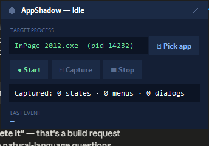
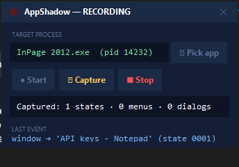

# AppShadow

**Use an application like you normally would. AppShadow turns that session into a structured map an AI agent can read.**

Most Windows software you might need to study, clone, or automate ships as a compiled binary with no accessible source and no documentation. The usual way to hand that interface to an AI coding agent is to screenshot every screen and describe each control by hand, which burns hours of work and tens of thousands of tokens on a single application. AppShadow replaces that manual step. It attaches to a running process, watches every menu you open and every dialog you trigger through the operating system's own UI Automation layer, and produces a single `app_map.json` you can hand straight to Claude or any other coding agent.

## Who this is for

Anyone who has to reconstruct a GUI they cannot see the source of.

**UI/UX and reverse engineers** mapping how an undocumented application is actually structured, screen by screen, control by control.
**Teams rebuilding legacy software** (Win32, MFC, Delphi, VB6, and other pre-web toolkits) who need an accurate inventory of every menu, dialog, and shortcut before writing a single line of the replacement.
**QA and RPA engineers** who need a reliable control tree (automation IDs, bounding rects, enabled state) to script against an application that was never designed to be automated.
**Accessibility auditors** checking what a screen reader can and cannot see, since AppShadow surfaces exactly what UI Automation exposes and exactly where it goes blank.
**Security and product researchers** building an attack surface or feature inventory of a GUI application without touching its binary.

If your job involves staring at an old application and typing out what it does, this tool is built to do that typing for you.

## How it works

You drive the application. AppShadow follows and captures automatically, with a manual hotkey as a backstop for anything the automatic detector misses.

1. **Event listener.** A `SetWinEventHook` subscription, filtered to your target's process ID, watches for the events that actually mean something changed: a window came to the foreground, a menu opened, a dialog appeared.
2. **Debounce.** A 300 millisecond settle timer collapses a burst of events into a single capture, so one click produces one state, not twenty.
3. **UIA snapshot.** The visible control tree is walked through `pywinauto`'s UI Automation backend: control type, name, automation ID, bounding rectangle, enabled state, and keyboard shortcut where the application exposes one.
4. **Screenshot.** The target window's region, and only that region, is grabbed as a PNG. Nothing else on your screen is ever captured.
5. **Diff and dedup.** A position independent fingerprint of the control tree tells AppShadow whether it has seen this exact screen before. A screen you have already visited gets a new navigation edge, not a duplicate node.
6. **Session graph.** Every capture is folded into a growing graph in memory: states are nodes, the action that led into each state is an edge. On Stop, that graph is written to disk as `app_map.json`.

A manual capture hotkey (`Ctrl+Shift+C` by default) skips straight to step 3 for anything that is drawn by the application itself and therefore invisible to the automatic listener, marking that state `needs_vision` so a screenshot fills the gap later.

## What you get

Every captured screen becomes one JSON node built for an AI agent to read directly, not for a human to page through:

```json
{
  "state_id": "state_0023",
  "kind": "menu_open",
  "window_title": "Document1 - InPage 2012",
  "breadcrumb": ["MainWindow", "File", "Export"],
  "reached_by": { "action": "left_click", "on": "MenuItem:Export", "from": "state_0019" },
  "screenshot": "screenshots/state_0023.png",
  "window_rect": [120, 80, 1280, 720],
  "controls": [
    { "type": "ToolBar", "name": "Export", "rect": [312, 148, 196, 84] },
    { "type": "MenuItem", "name": "Export as PDF…", "rect": [312, 148, 196, 24],
      "depth": 1, "class_name": "MenuItem", "shortcut": "Ctrl+Shift+E",
      "help_text": "Save a PDF copy of this document", "leads_to": "state_0024" },
    { "type": "MenuItem", "name": "Export as Image…", "rect": [312, 176, 196, 24],
      "depth": 1, "leads_to": null },
    { "type": "MenuItem", "name": "Publish to Web…", "rect": [312, 204, 196, 24],
      "depth": 1, "enabled": false }
  ],
  "unexplored": ["MenuItem:Export as Image…"],
  "ts": "2026-07-12T14:03:22+05:00"
}
```

Enough is recorded to rebuild the screen, not just list it. `rect` is `[x, y, width, height]` relative to the window, so position and size are usable directly instead of having to be derived from screen coordinates, and `window_rect` keeps the absolute position recoverable without baking the user's monitor layout into the map. `depth` carries the real nesting from the accessibility tree, so a flat list still reconstructs exactly which button sits inside which toolbar inside which pane, which is what any HTML or React rebuild needs. Where the application exposes them, `class_name`, `help_text` and the `checked` / `expanded` / `selected` flags come along too.

Three details carry the navigation. `leads_to: null` on an enabled control means you saw it but never clicked it, which is what lets AppShadow print an honest coverage report on Stop instead of a silent guess. `reached_by` turns a pile of flat screenshots into a graph, so the agent learns the navigation flow between screens, not just their individual layouts. And any `Edit` or `Password` control is recorded as `value_redacted: true`, meaning its existence is captured and its content never is, in the screenshot as well as in the JSON.

On cost, measured rather than estimated: in a real WordPad session a simple dialog node came to about 90 tokens, a menu about 290, and a dense ribbon window with 83 controls about 2,400. The whole six screen session was roughly 14,000 tokens. Describing those same screens to a model in prose runs about 1,500 tokens each and has to be redone by hand every time the app changes.

## Validated against a real, no-framework application

AppShadow was built and tested against InPage 2012, a compiled Windows desktop publishing application with no accessible framework and no documentation. The results shaped several design decisions:

| Target | Controls captured | Snapshot time | What it showed |
|---|---|---|---|
| Notepad (baseline) | 24 | ~30 ms | Clean control tree; the Edit body was correctly redacted |
| InPage 2012, full main window | 32 | ~530 ms | Toolbars, rulers, and the canvas are owner drawn and invisible to UI Automation; correctly flagged `needs_vision: true` |
| InPage 2012, File menu (scoped to the popup) | 5 | ~26 ms | Full labels, shortcuts, and automation IDs, well inside the budget a closing menu allows |

The 20x gap between a whole window snapshot and a menu scoped one is not about tree size. InPage's own UI Automation provider simply answers slowly across the whole window, so AppShadow scopes every menu capture to the popup's window handle rather than the application's main window, which is what keeps it fast enough to beat a menu that can close in under a second. Full findings, including how a tab embedded shortcut like `"New...\tCtrl+N"` gets split into a proper `shortcut` field, are in [`docs/phase2_findings.md`](docs/phase2_findings.md) and [`docs/phase3_findings.md`](docs/phase3_findings.md).

## The recorder window

A small, always on top window that never covers the application you are mapping. Pick a target by dragging a crosshair onto it, press Start, and drive the application as you normally would.

<p align="center">
  
  &nbsp;&nbsp;
  
</p>

The status strip shows a live count of captured states, menus, and dialogs. The last event line tells you exactly what was just captured and where it came from. Global hotkeys (`Ctrl+Shift+C` to force a capture, `Ctrl+Shift+X` to stop) work even while the target application has focus.

## Getting started

New to this? The [user guide](docs/USER_GUIDE.md) walks through installation and a
first recording step by step, assuming no prior experience. The short version
follows.

Requires Windows and Python 3.11 or newer.

```bash
python -m venv .venv
.venv\Scripts\pip install -r requirements.txt
.venv\Scripts\python main.py
```

Drag the crosshair from **Pick app** onto the window you want to map, press **Start**, and use the application normally. Press **Stop** when you are done, and `app_map.json` along with a `screenshots/` folder will be waiting in a new `sessions/` directory.

Two other entry points are useful on their own:

```bash
# One shot: snapshot a single window right now and print the JSON
.venv\Scripts\python -m scrapers.windows_uia --title-re ".*Notepad.*"

# Headless: record a session from the command line, no window required
.venv\Scripts\python recorder.py --title-re ".*YourApp.*" --seconds 60 --app "YourApp.exe"
```

## Tests

The core invariants (the JSON contract, the deduplication fingerprint, edge wiring, the debounce timer, and the exporters) are covered by a suite that needs no live application and no dependencies beyond the standard library:

```bash
.venv\Scripts\python tests\test_core.py     # or: python -m pytest tests/
```

The scraper itself needs a real target to be meaningful, so its behaviour is documented through measured findings in [`docs/`](docs/) rather than mocked.

## Architecture

The core is deliberately platform agnostic. Everything that knows about Windows lives behind one abstract interface, which is what will let this project grow scrapers for the web, macOS, or Android without touching a single line of the schema or the session graph.

```
appshadow/
├─ main.py                 tkinter recorder window, global hotkeys, toasts
├─ recorder.py              ShadowRecorder: wires the hook, debounce, scraper and screenshot grabber together
├─ config.py                DPI awareness, timing, hotkeys, redaction rules
├─ core/
│  ├─ schema.py             Control, Edge, State, Session (the JSON contract)
│  ├─ session.py            tree hash diff engine, debounce, coverage tracking
│  └─ exporter.py           app_map.json, graph.mmd, coverage report, sharding
├─ scrapers/
│  ├─ base.py                abstract Scraper interface, the cross-platform seam
│  └─ windows_uia.py         pywinauto UIA walker + WinEventHook listener
├─ capture/
│  └─ screenshot.py          mss window region grabs
├─ examples/                a hand built sample session and a React component rebuilt from nothing but its JSON
├─ tests/                   core invariants, no live application required
└─ docs/                     user guide, verification record, and findings from real applications
```

Documentation lives in [`docs/`](docs/): the [user guide](docs/USER_GUIDE.md) for
getting started, the [verification record](docs/definition_of_done.md) for what
was measured and what fell short, and the phase findings for what testing against
a real compiled application actually revealed.

## What is built and what is next

Capturing a live session end to end works today: the event listener, the debounce and diff engine, the UIA snapshot function, window scoped screenshots, the recorder window, global hotkeys, autosave during long sessions, and on Stop a coverage report plus the three artefacts below.

```
session_2026-07-21_1432/
├─ app_map.json      the structured map, feed this to your agent
├─ app_graph.mmd     how the application is organised
├─ graph.mmd         the order screens were captured in
└─ screenshots/      state_0001.png … state_00NN.png
```

The two diagrams answer different questions and it is worth knowing which you want. `graph.mmd` is the session: state_0001 to state_0002 to state_0003, in capture order, which is useful for checking a recording and close to useless for understanding software. `app_graph.mmd` is the program: the app at the root, each screen branching off it, and each menu item drawn as a labelled edge into whatever it opens. Controls nobody opened still appear, dashed, because "this exists and was never explored" is exactly what a reader needs to see.

Both shape each node by what it is: rectangle for a window, stadium for a menu, hexagon for a dialog.

What remains on the roadmap: per menu sharding is implemented but not yet wired to a command line flag, and the additional scrapers (web, macOS, Android) that `scrapers/base.py` already reserves a seam for.

## License

Released under the [MIT License](LICENSE).
